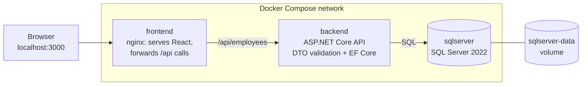
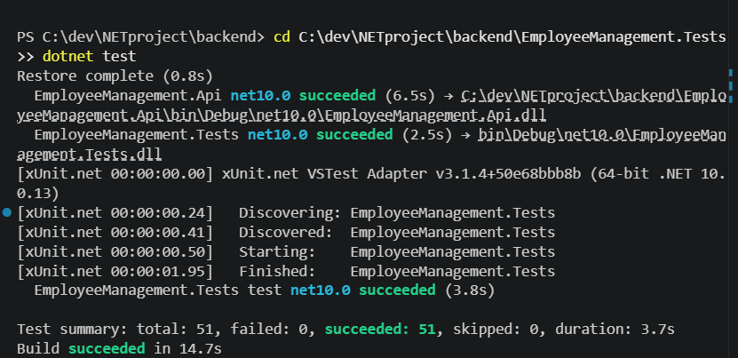
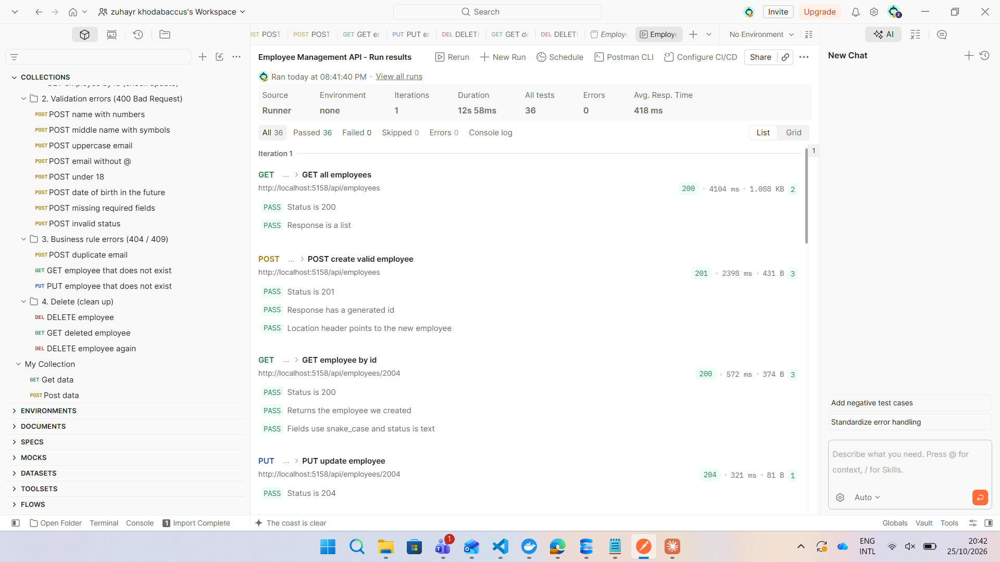

# Employee Management System

A full-stack Employee Management System built for the **BDO IT Consulting Internship 2026** (.NET Full-Stack Learning Work Plan).

Users can create, view, update and delete employee records through a React interface backed by an ASP.NET Core Web API and a SQL Server database. The whole application runs with a single Docker Compose command.

---

## Contents

- [Tech stack](#tech-stack)
- [Architecture](#architecture)
- [Project structure](#project-structure)
- [Running the application with Docker (recommended)](#running-the-application-with-docker-recommended)
- [Running locally for development](#running-locally-for-development)
- [API endpoints](#api-endpoints)
- [Validation rules](#validation-rules)
- [Testing](#testing)
- [Database migrations](#database-migrations)
- [Configuration and secrets](#configuration-and-secrets)
- [Git workflow](#git-workflow)

---

## Tech stack

| Layer        | Technology                                  |
|--------------|---------------------------------------------|
| Frontend     | React 19, Vite, served by nginx in Docker   |
| Backend      | C#, ASP.NET Core Web API (.NET 10)          |
| Data access  | Entity Framework Core 10                    |
| Database     | SQL Server 2022                             |
| Testing      | xUnit, EF Core InMemory, Postman            |
| Containers   | Docker, Docker Compose                      |

---

## Architecture



**How a request travels (example: adding an employee)**

1. The user submits the React form. React sends `POST /api/employees` with a JSON body.
2. nginx (in Docker) or the Vite dev proxy (locally) forwards `/api/...` to the backend.
3. ASP.NET Core converts the JSON (`first_name`) into an `EmployeeRequestDto` (`FirstName`).
4. `[ApiController]` validates the DTO. If a rule fails, the API returns **400** with `{ "error": "..." }`.
5. `EmployeesController` checks the email is not already used (**409 Conflict** if it is).
6. The DTO is mapped to an `Employee` entity and saved with `SaveChangesAsync()`. EF Core generates the SQL `INSERT`.
7. The API returns **201 Created** with an `EmployeeResponseDto`, and React refreshes the list.

**Design decisions**

- **Entities vs DTOs:** `Employee` is the database shape. `EmployeeRequestDto` defines what clients may send (no `Id`, so clients cannot set one) and holds all validation rules. `EmployeeResponseDto` defines what is returned.
- **Dependency injection:** `AppDbContext` is registered in `Program.cs` and injected into the controller. The tests inject an in-memory database instead.
- **Validation in two places:** the frontend validates for a good user experience, and the backend validates again because the API can be called directly.
- **JSON naming:** the API uses `snake_case` JSON (`first_name`) to match the frontend, while C# keeps `PascalCase`.

---

## Project structure

```
NETproject/
├── backend/
│   ├── EmployeeManagement.Api/          ASP.NET Core Web API
│   │   ├── Controllers/                 EmployeesController (5 endpoints)
│   │   ├── Data/                        AppDbContext
│   │   ├── Dtos/                        Request and response DTOs
│   │   ├── Entities/                    Employee, EmployeeStatus
│   │   ├── Migrations/                  EF Core migrations
│   │   ├── Validation/                  MinimumAgeAttribute (18+ rule)
│   │   ├── Program.cs                   Startup, DI, JSON and error settings
│   │   ├── Dockerfile                   Multi-stage build (SDK → runtime)
│   │   └── run-api.ps1                  Local start script (uses dotnet exec)
│   └── EmployeeManagement.Tests/        xUnit tests
│       ├── Controllers/                 Endpoint tests (in-memory database)
│       ├── Validation/                  DTO and age-rule tests
│       └── Helpers/                     Shared test data and validation helper
├── frontend/                            React app (Vite) + nginx config + Dockerfile
├── postman/                             Postman collection (19 API tests)
├── docs/                                Test evidence screenshots
├── docker-compose.yml                   sqlserver + backend + frontend
├── .env.example                         Template for the database password
└── README.md
```

---

## Running the application with Docker (recommended)

### Prerequisites

- [Docker Desktop](https://www.docker.com/products/docker-desktop/) (with WSL 2 on Windows)
- Git

### Steps

1. **Clone the repository**

   ```powershell
   git clone https://github.com/Zuhayrk13/NETproject.git
   cd NETproject
   ```

2. **Create the `.env` file** from the template and set a strong password
   (SQL Server requires 8+ characters with upper case, lower case, a number and a symbol):

   ```powershell
   Copy-Item .env.example .env
   ```

   ```
   SA_PASSWORD=YourStr0ng!Password
   ```

   `.env` is git-ignored, so the password is never committed.

3. **Build and start everything**

   ```powershell
   docker compose up --build
   ```

   The first build takes a few minutes. SQL Server starts first; the backend waits until its healthcheck passes, then applies the EF Core migrations automatically.

4. **Open the application**

   | What                 | Address                                  |
   |----------------------|------------------------------------------|
   | Web application      | http://localhost:3000                    |
   | API                  | http://localhost:5158/api/employees      |
   | SQL Server (SSMS)    | `localhost,1434`, login `sa`, password from `.env`, tick *Trust server certificate* |

### Useful commands

| Command                                  | Effect                                                        |
|------------------------------------------|---------------------------------------------------------------|
| `docker compose up --build`              | Build and start all services                                  |
| `docker compose up --build -d frontend`  | Rebuild and restart only the frontend, in the background      |
| `docker compose down`                    | Stop and remove the containers. **Data is kept** in the volume |
| `docker compose down -v`                 | Stop and also **delete the database volume** (all data)       |
| `docker compose logs backend`            | Show the backend's output                                     |

### Data persistence

SQL Server stores its files in the named volume `sqlserver-data`, which outlives the containers. Records survive `docker compose down` followed by `docker compose up`.

---

## Running locally for development

### Prerequisites

- .NET 10 SDK
- Node.js (LTS)
- Docker Desktop (for SQL Server)
- EF Core tools: `dotnet tool install --global dotnet-ef --version 10.0.13`

### 1. Start SQL Server

```powershell
docker run -e "ACCEPT_EULA=Y" -e "MSSQL_SA_PASSWORD=<your password>" `
  -p 1433:1433 --name ems-sql `
  -v ems-sql-data:/var/opt/mssql `
  -d mcr.microsoft.com/mssql/server:2022-latest
```

### 2. Store the connection string in User Secrets

```powershell
cd backend/EmployeeManagement.Api
dotnet user-secrets set "ConnectionStrings:DefaultConnection" 'Server=localhost,1433;Database=EmployeeManagementDb;User Id=sa;Password=<your password>;TrustServerCertificate=True'
```

### 3. Create the database and start the API

```powershell
dotnet ef database update
dotnet run
```

The API listens on `http://localhost:5158`.

> **If `dotnet run` is blocked** (for example by a company device policy), use the script instead. It builds the project, sets `ASPNETCORE_ENVIRONMENT=Development` and `ASPNETCORE_URLS=http://localhost:5158`, then starts the API with `dotnet exec`:
>
> ```powershell
> .\run-api.ps1
> ```

### 4. Start the frontend

In a second terminal:

```powershell
cd frontend
npm install
npm run dev
```

Open the address Vite prints (usually http://localhost:5173). Vite forwards `/api` requests to the API on port 5158.

---

## API endpoints

Base URL: `http://localhost:5158`

| Method | Endpoint              | Description             | Success          | Errors                 |
|--------|-----------------------|-------------------------|------------------|------------------------|
| GET    | `/api/employees`      | Retrieve all employees  | 200 OK           | –                      |
| GET    | `/api/employees/{id}` | Retrieve employee by ID | 200 OK           | 404                    |
| POST   | `/api/employees`      | Create a new employee   | 201 Created      | 400, 409               |
| PUT    | `/api/employees/{id}` | Update employee details | 204 No Content   | 400, 404, 409          |
| DELETE | `/api/employees/{id}` | Delete an employee      | 204 No Content   | 404                    |

**Status codes**

| Code | Meaning in this API                                   |
|------|-------------------------------------------------------|
| 200  | Request processed successfully                        |
| 201  | Employee created (response includes a `Location` header) |
| 204  | Update or deletion completed                          |
| 400  | Invalid data submitted (see validation rules)         |
| 404  | Employee does not exist                               |
| 409  | Email address already used by another employee        |

**Example request: `POST /api/employees`**

```json
{
  "first_name": "Alex",
  "middle_name": "James",
  "last_name": "Brown",
  "date_of_birth": "1995-06-15",
  "email": "alex.brown@bdo.mu",
  "department": "Information Technology",
  "job_title": "Software Engineer",
  "status": "Active"
}
```

**Example response: `201 Created`**

```json
{
  "id": 1,
  "first_name": "Alex",
  "middle_name": "James",
  "last_name": "Brown",
  "date_of_birth": "1995-06-15",
  "email": "alex.brown@bdo.mu",
  "department": "Information Technology",
  "job_title": "Software Engineer",
  "status": "Active"
}
```

**Example error: `400 Bad Request`**

```json
{
  "error": "First name must contain letters only. Spaces, hyphens and apostrophes are allowed.",
  "errors": {
    "FirstName": ["First name must contain letters only. Spaces, hyphens and apostrophes are allowed."]
  }
}
```

---

## Validation rules

The specification lists Full Name, Email, Department, Job Title and Status. To match the existing frontend, the name is split into first, optional middle and last name, and a date of birth with an 18+ rule was added.

| Field                  | Rules                                                                 |
|------------------------|-----------------------------------------------------------------------|
| First name, last name  | Required, max 50 characters, letters only; single spaces, hyphens and apostrophes allowed between letters (e.g. `Jean-Pierre`, `O'Neil`, `Zoë`) |
| Middle name            | Optional; if provided, same rules as the other names                  |
| Date of birth          | Required, employee must be at least 18, cannot be in the future       |
| Email                  | Required, max 150 characters, lowercase, valid format, **unique**     |
| Department, job title  | Required, max 100 characters                                          |
| Status                 | Required, `Active` or `Inactive`                                      |
| Employee ID            | Generated by the database; clients cannot set it                      |

Email uniqueness is enforced twice: the controller returns **409 Conflict**, and the database has a unique index as a safety net.

---

## Testing

The project has two kinds of automated tests.

| | xUnit (unit tests) | Postman (API tests) |
|---|---|---|
| What is tested | C# code called directly | The running API over HTTP |
| Needs the app running | No | Yes |
| Database | EF Core in-memory, fresh per test | Real SQL Server |
| Number of tests | 51 | 19 requests with automatic checks |

### xUnit tests

```powershell
cd backend/EmployeeManagement.Tests
dotnet test
```

To list every test by name:

```powershell
dotnet test --logger "console;verbosity=normal"
```

| Test file                                   | Tests | Covers |
|---------------------------------------------|-------|--------|
| `Validation/EmployeeRequestDtoTests.cs`     | 33    | Name, email and required-field rules (valid and invalid inputs) |
| `Validation/MinimumAgeAttributeTests.cs`    | 5     | 18+ rule boundaries: 18 today passes, 18 tomorrow fails, future date fails |
| `Controllers/EmployeesControllerTests.cs`   | 13    | Every endpoint: status codes and the effect on the database |

**Result: 51 passed, 0 failed.**



### Postman tests

1. Start the application (Docker or locally) so the API is on `http://localhost:5158`.
2. In Postman, **Import** `postman/EmployeeManagement.postman_collection.json`.
3. Open the collection's **⋯** menu → **Run** → **Run Employee Management API**.

The collection runs in order: a valid create saves the new ID for the following requests, and each request checks its status code and response.

| Folder                    | Checks                                                                  |
|---------------------------|-------------------------------------------------------------------------|
| 1. Happy path             | Get all (200), create (201), get by ID (200), update (204), verify update |
| 2. Validation errors      | Invalid names, uppercase email, missing `@`, under 18, future date, missing fields, invalid status (all 400) |
| 3. Business rules         | Duplicate email (409), unknown ID for GET and PUT (404)                 |
| 4. Delete                 | Delete (204), get deleted (404), delete again (404)                     |



### Defect found through testing

Writing the age-rule tests showed that `MinimumAgeAttribute` returned its error without the field name, so the error was not linked to `DateOfBirth`. The attribute now passes the member name with its error, matching the built-in validation attributes.

---

## Database migrations

The database schema is managed with Entity Framework Core migrations.

| Migration              | Change                                                                 |
|------------------------|------------------------------------------------------------------------|
| `InitialCreate`        | Creates the `Employees` table and the unique index on `Email`          |
| `UpdateEmployeeFields` | Splits the name into first/middle/last, adds date of birth and a text `Status` column |

- **In Docker**, the API applies pending migrations automatically at startup (`Database.Migrate()` in `Program.cs`).
- **Locally**, run `dotnet ef database update` from `backend/EmployeeManagement.Api`.
- **To change the schema:** edit the entity, then run `dotnet ef migrations add <Name>` and `dotnet ef database update`.

---

## Configuration and secrets

No credentials are stored in committed files.

| Environment | Where the connection string comes from |
|-------------|----------------------------------------|
| Local development | .NET User Secrets (`ConnectionStrings:DefaultConnection`), stored outside the repository |
| Docker | Environment variable `ConnectionStrings__DefaultConnection`, built from `SA_PASSWORD` in the git-ignored `.env` file |

`.env.example` is committed as a template showing which values to set.

---

## Git workflow

- `main` only changes through a reviewed pull request; all work happens on `develop`.
- Commit messages follow `type: short description` (`feat`, `fix`, `refactor`, `docs`, `test`, `chore`).
- Work is pushed daily before 4:00 PM; unfinished work goes on a `-wip` branch.
- Build output (`bin/`, `obj/`), `node_modules/` and `.env` are excluded by `.gitignore`.
